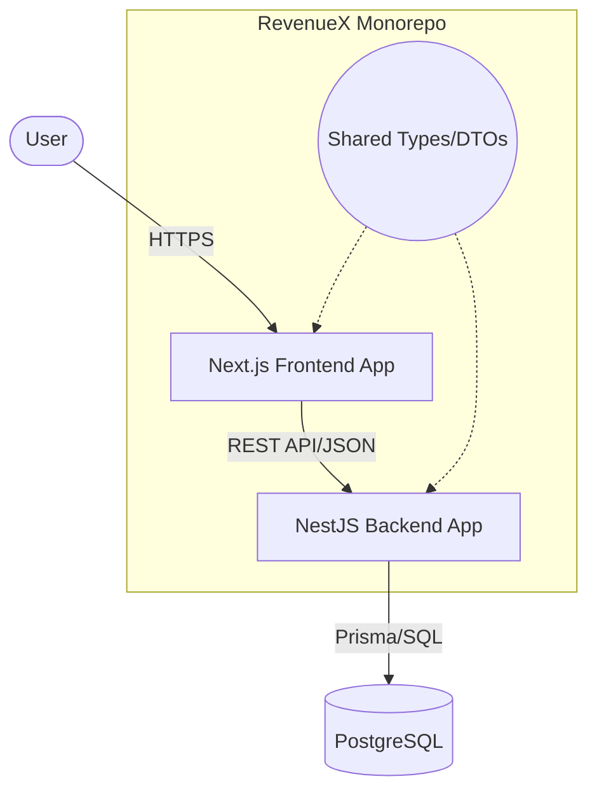

# Architecture Document

## High-Level Architecture
RevenueX is built as a monorepo containing:
- **Frontend (Web)**: Next.js + Tailwind CSS for a highly responsive, modern dashboard.
- **Backend (API)**: NestJS REST API for robust business logic, role-based access control, and anomaly detection.
- **Database**: PostgreSQL for relational data storage, accessed via Prisma ORM for type safety.
- **Shared Packages**: Shared Typescript types, DTOs, and utility functions across frontend and backend.

## Flow of Data
1. **User Request**: The user interacts with the Next.js frontend (e.g., uploading a CSV or viewing the dashboard).
2. **API Communication**: The frontend sends a REST request to the NestJS backend.
3. **Authentication**: NestJS verifies the JWT token (or session) to ensure the user has the correct role (Admin or Analyst).
4. **Business Logic**: NestJS performs validation (using class-validator), processes the request (e.g., parsing CSV, calculating leakage), and queries the database using Prisma.
5. **Database**: PostgreSQL securely stores the data.
6. **Response**: The backend formats the response and sends it back to the frontend to render the UI updates.

## Tech Stack
- Frontend: React 18, Next.js 14+, Tailwind CSS, Recharts, Lucide Icons, Zod (validation)
- Backend: NestJS 10+, Prisma ORM, Passport (JWT Auth), class-validator, class-transformer
- Database: PostgreSQL
- Tooling: TypeScript, ESLint, Prettier

## System Diagram

