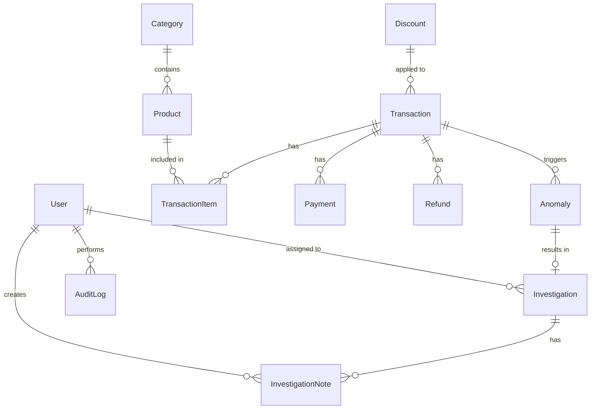

# Entity Relationship Diagram (ERD)

## Overview
RevenueX relies on a normalized relational database to manage users, transactions, anomalies, and investigations.

## Entities
1. **User**: System users (Admin, Analyst)
2. **Category**: Product categories
3. **Product**: Items being sold
4. **Transaction**: Core business transactions
5. **TransactionItem**: Line items for transactions
6. **Payment**: Payment attempts for transactions
7. **Discount**: Discount codes applied
8. **Refund**: Refunds processed
9. **Anomaly**: Suspicious transactions detected by the system
10. **Investigation**: Cases opened to investigate anomalies
11. **InvestigationNote**: Notes added to investigations by analysts
12. **Alert**: System alerts for critical events
13. **Report**: Saved generated reports
14. **AuditLog**: System activity logs

## Mermaid ERD


## Prisma Schema Draft
```prisma
model User {
  id        String   @id @default(uuid())
  email     String   @unique
  password  String
  name      String
  role      Role     @default(ANALYST)
  createdAt DateTime @default(now())
  updatedAt DateTime @updatedAt
  
  investigations Investigation[]
  notes          InvestigationNote[]
  logs           AuditLog[]
}

enum Role {
  ADMIN
  ANALYST
}

model Transaction {
  id            String   @id @default(uuid())
  customerName  String
  customerEmail String
  amount        Float
  status        TxStatus
  date          DateTime
  discountId    String?
  createdAt     DateTime @default(now())
  updatedAt     DateTime @updatedAt

  discount      Discount?         @relation(fields: [discountId], references: [id])
  items         TransactionItem[]
  payments      Payment[]
  refunds       Refund[]
  anomalies     Anomaly[]
}

enum TxStatus {
  SUCCESS
  FAILED
  PENDING
  REFUNDED
}

// Additional models will follow the Prisma schema implementation.
```
